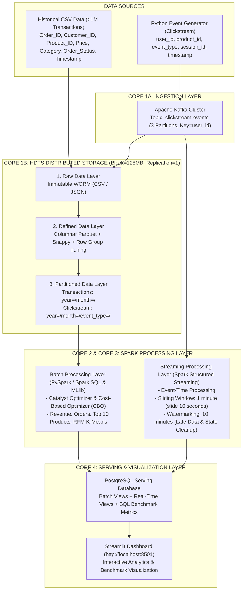

# 🛒 Hệ Thống Đường Ống Dữ Liệu Thương Mại Điện Tử Thời Gian Thực (IT4931 - Nhóm 3)

**Học phần:** IT4931 - Lưu trữ và Xử lý Dữ liệu Lớn (Trường CNTT&TT - Đại học Bách Khoa Hà Nội)  
**Giảng viên hướng dẫn:** TS. Vũ Tuyết Trinh  
**Nhóm thực hiện:** Nhóm 3

| Họ và tên | MSSV |
|---|---|
| **Phạm Văn Quyết** | `202416331` |
| **Vũ Việt Tiến** | `202416362` |
| **Nguyễn Xuân Hồng Quân** | `202416321` |
| **Đặng Minh Quân** | `202416323` |

---

## 📌 I. Mục Tiêu Cốt Lõi & Bài Toán Nghiệp Vụ (Mô Hình 5V)

Dự án xây dựng và triển khai một hệ thống lưu trữ và xử lý dữ liệu thương mại điện tử theo mô hình **Lambda Architecture** trên nền tảng **HDFS**, kết hợp định dạng lưu trữ hướng cột **Apache Parquet**, nén **Snappy**, và chiến lược **Partitioning** (`year=/month=/`, bổ sung `event_type=` cho luồng clickstream); đồng thời triển khai hai nhánh xử lý **Batch (Spark SQL & MLlib)** và **Streaming (Kafka & Spark Structured Streaming)** để đánh giá thực nghiệm hiệu năng truy vấn, dung lượng I/O quét và tài nguyên phần cứng.

### Phân Tích Đặc Trưng 5V Của Dữ Liệu Lớn
| Đặc trưng 5V | Thể hiện trong Hệ thống | Giải pháp Kỹ thuật Triển khai |
|---|---|---|
| **Volume** *(Dung lượng)* | **>1,000,000 bản ghi** giao dịch lịch sử (`Order_ID, Customer_ID, Product_ID, Price, Category, Order_Status, Timestamp`) và luồng nhật ký Clickstream. | Lưu trữ phân tán trên **HDFS** (`Block size = 128MB`, `Replication = 1`), chuyển đổi sang định dạng cột **Parquet** + nén **Snappy** + *Dictionary Encoding*. |
| **Velocity** *(Tốc độ)* | Luồng sự kiện Clickstream (`user_id, product_id, event_type, session_id, timestamp`) phát sinh liên tục theo thời gian thực. | **Apache Kafka** (`clickstream-events`, *Semantic Partitioning* theo `user_id`) kết hợp **Spark Structured Streaming** (*Sliding Window 1 phút, trượt 10 giây*). |
| **Variety** *(Đa dạng)* | Kết hợp dữ liệu bảng **CSV** có cấu trúc (giao dịch lịch sử, danh mục sản phẩm) và nhật ký **JSON** bán cấu trúc (luồng sự kiện người dùng). | Chuẩn hóa đa định dạng tại tầng **Raw Data Layer** trên HDFS trước khi hợp nhất sang Parquet tại **Refined & Partitioned Layer**. |
| **Veracity** *(Độ tin cậy)* | Xử lý dữ liệu khuyết thiếu (`NULL Category`), giá trị bất thường (`Price <= 0`), bản ghi trùng lặp (`Order_ID`), và dữ liệu luồng đến muộn (*Late-Arriving Data*). | Quy trình làm sạch tự động tại tầng **Refined Layer** và cơ chế **Watermarking (10 phút)** trên Spark Structured Streaming chống rò rỉ bộ nhớ *State Store*. |
| **Value** *(Giá trị)* | Cung cấp báo cáo doanh thu, Top 10 sản phẩm bán chạy, phân khúc khách hàng **RFM (Spark MLlib K-Means)** và giám sát chuyển đổi thời gian thực. | Lưu trữ kết quả tổng hợp tại **PostgreSQL Serving Layer** và trực quan hóa trên **Streamlit Dashboard**. |

---

## 🏗️ II. Kiến Trúc Hệ Thống 4 Khối Cốt Lõi (Lambda Architecture)



---

## 📂 III. Cấu Trúc Thư Mục Dự Án

```text
IT4931_ecommerce-data-pipeline/
├── docker/
│   ├── Dockerfile.generator       # Container cho Python Clickstream Event Generator
│   ├── Dockerfile.spark           # Container cho Apache Spark Master/Worker + JDBC/Kafka drivers
│   └── Dockerfile.dashboard       # Container cho Streamlit Visualization Dashboard
├── docs/
│   ├── BAO_CAO_CHI_TIET_DU_AN_IT4931.md # Báo cáo tổng hợp chi tiết: Lý thuyết, Công cụ, Code & Luồng hoạt động
│   ├── ARCHITECTURE_AND_THEORY.md       # Chuyên khảo lý thuyết IT4931 (HDFS, Parquet, Kafka, Spark, Lambda)
│   └── EXPERIMENTAL_REPORT.md           # Báo cáo kết quả thực nghiệm định lượng trên 1,050,000 bản ghi
├── notebooks/
│   └── IT4931_Ecommerce_Analysis_and_Benchmark.ipynb # Notebook phân tích, MLlib RFM & Benchmark
├── scripts/
│   ├── run_local_demo.py          # Orchestrator chạy toàn bộ pipeline >1M bản ghi & Benchmark
│   └── submit_spark_jobs.sh       # Script nạp HDFS và submit Spark Batch & Streaming trong Docker
├── sql/
│   └── init.sql                   # Schema khởi tạo các bảng PostgreSQL tại tầng Serving
├── src/
│   ├── config.py                  # Cấu hình tập trung HDFS (128MB block), Parquet, Kafka, Spark
│   ├── ingestion/
│   │   ├── historical_data_loader.py # Bộ sinh & chuẩn hóa >1M bản ghi giao dịch lịch sử / Kaggle CSV
│   │   └── event_generator.py     # Bộ sinh sự kiện Clickstream thời gian thực & Late Data cho Kafka
│   ├── storage/
│   │   └── hdfs_storage_manager.py # Quản lý 3 tầng HDFS (Raw -> Refined Parquet/Snappy -> Partitioned)
│   ├── batch/
│   │   └── batch_processor.py     # Xử lý Batch bằng Spark SQL (Catalyst/CBO) & Spark MLlib K-Means RFM
│   ├── streaming/
│   │   ├── stream_processor.py    # Spark Structured Streaming (Sliding Window 1m/10s & Watermark 10m)
│   │   └── run_spark_stream_job.py # Entrypoint cho spark-submit streaming job
│   ├── benchmark/
│   │   └── sql_benchmark.py       # Thực nghiệm Benchmark SQL đối chứng 3 kiến trúc lưu trữ
│   ├── serving/
│   │   └── db_client.py           # Kết nối PostgreSQL với cơ chế tự động fallback SQLite cục bộ
│   └── dashboard/
│       └── app.py                 # Giao diện trực quan hóa Streamlit Dashboard (4 Tabs)
├── tests/
│   └── test_pipeline.py           # Bộ kiểm thử tự động toàn diện (Unit & Integration Tests)
├── docker-compose.yml             # Triển khai 9 dịch vụ container theo đúng 5 tầng kiến trúc
├── hadoop.env                     # Cấu hình HDFS (dfs.blocksize=128MB, dfs.replication=1)
└── requirements.txt               # Danh sách thư viện Python
```

---

## 🚀 IV. Hướng Dẫn Khởi Chạy & Thực Nghiệm

### Phương Án 1: Triển Khai Toàn Bộ Cụm Hạ Tầng Với Docker Compose
1. Khởi tạo đồng bộ 9 dịch vụ container (Zookeeper, Kafka, Event Generator, HDFS NameNode, HDFS DataNode, Spark Master, Spark Worker, PostgreSQL, Streamlit Dashboard):
   ```bash
   docker compose up -d --build
   ```
2. Nạp tập dữ liệu lịch sử (>1,000,000 bản ghi) lên HDFS và kích hoạt các tác vụ Spark Batch, SQL Benchmark & Structured Streaming:
   ```bash
   bash scripts/submit_spark_jobs.sh
   ```
3. Truy cập các giao diện quản trị và trực quan hóa:
   - **Streamlit Dashboard:** `http://localhost:8501`
   - **HDFS NameNode Web UI:** `http://localhost:9870`
   - **Spark Master Web UI:** `http://localhost:8080`
   - **PostgreSQL Serving DB:** `localhost:5432` (`db=ecommerce_serving`, `user=postgres`, `password=postgres`)

### Phương Án 2: Chạy Thực Nghiệm & Kiểm Thử Trực Tiếp Trên Máy Cục Bộ (Standalone Mode)
1. Khởi tạo môi trường ảo và cài đặt thư viện:
   ```bash
   python -m venv .venv
   # Windows PowerShell:
   .\.venv\Scripts\pip install -r requirements.txt
   ```
2. Chạy toàn bộ đường ống dữ liệu với **1,050,000 bản ghi giao dịch** và thực nghiệm **SQL Benchmark**:
   ```bash
   .\.venv\Scripts\python scripts/run_local_demo.py --rows 1050000 --events 3600
   ```
3. Chạy bộ kiểm thử tự động (`pytest`):
   ```bash
   .\.venv\Scripts\pytest -v
   ```
4. Khởi động giao diện **Streamlit Dashboard**:
   ```bash
   .\.venv\Scripts\streamlit run src/dashboard/app.py
   ```

